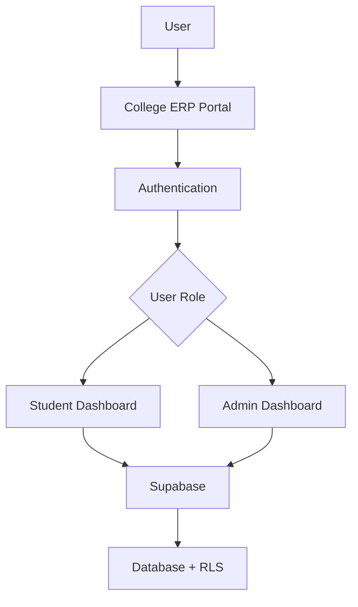
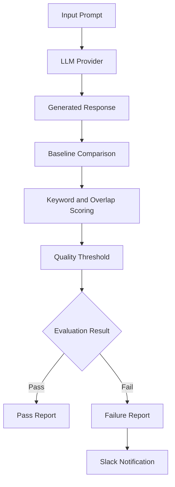

<!-- ================================================= -->
<!--              SHIVA SHAKTI DUBEY                  -->
<!--             GITHUB PROFILE README                -->
<!-- ================================================= -->

<div align="center">


<br/><br/>

<a href="https://www.linkedin.com/in/shiva-shakti-dubey-495337259">

</a>
<a href="https://github.com/Shivashakti-1">

</a>
<a href="mailto:shivashaktidubey@gmail.com">

</a>
<a href="https://x.com/Shivashakti0007">

</a>

<br/><br/>


</div>

---

## 👨‍💻 About Me

```java
public class Developer {

    String name = "Shiva Shakti Dubey";
    String degree = "B.Tech in Information Technology";
    String role = "Software Developer";

    String[] languages = {
        "C", "C++", "Java", "Python"
    };

    String[] interests = {
        "Backend Development",
        "Data Structures & Algorithms",
        "System Design",
        "Problem Solving"
    };

    String currentFocus = "Java Backend Development";

    void sayHello() {
        System.out.println(
            "Building, Learning and Improving Every Day!"
        );
    }
}
```

- 🎓 B.Tech graduate in Information Technology (2026).
- 💻 Interested in Software Development and Backend Engineering.
- ☕ Working with Java, Spring Boot and REST APIs.
- 🧠 Practicing DSA in C++ and Java.
- 🛠️ Building practical projects and exploring new technologies.
- 🚀 Focused on writing clean, maintainable and efficient code.

---

## ⚡ Technical Arsenal

### Programming Languages

<p>

</p>

### Backend Development

<p>

</p>

### Database

<p>

</p>

### DevOps & Version Control

<p>

</p>

### Development Tools & Web Technologies

<p>

</p>

### Core Computer Science

<p>


</p>

---

## 🚀 Featured Projects

### 01. College ERP Portal

<div align="left">

<a href="https://github.com/Shivashakti-1/campusflow-erp">

</a>
<a href="https://shivashakti-1.github.io/campusflow-erp/">

</a>

</div>

**Tech Stack:** HTML, CSS, JavaScript, Supabase, GitHub Actions

A responsive college ERP portal with separate student and admin dashboards.

**Key Features:**

- Independently developed a responsive college ERP portal with student record management.
- Implemented email/password authentication, role-based access control and Supabase Row Level Security (RLS).
- Automated deployment using GitHub Actions and GitHub Pages.

**Architecture Overview**



---

### 02. LLM Regression Detector

<div align="left">

<a href="https://github.com/Shivashakti-1/llm-regression-detector">

</a>
<a href="https://llm-regression-detector-cyl7hqumg4cstefzqbvt8t.streamlit.app/">

</a>

</div>

**Tech Stack:** Python, Streamlit, OpenAI API, Docker, GitHub Actions

A Python-based tool that detects regressions in LLM-generated responses by comparing outputs against saved baseline responses.

**Key Features:**

- Developed keyword and overlap-based scoring with configurable quality thresholds.
- Implemented mock and OpenAI API providers for reproducible and live evaluations.
- Integrated GitHub Actions and Docker to automate evaluations, generate reports and send Slack notifications for failed evaluations.

**Architecture Overview**



---

## 🏆 Achievements

<div align="center">


</div>

- Solved 450+ coding problems across LeetCode, GeeksforGeeks, NeetCode and HackerRank.
- Earned 5-star badges in C and C++ on HackerRank.
- Secured Rank 226 in CodeChef Starters 262.
- Achieved top ranks in multiple college-level coding competitions.

---

## 📜 Certifications

| Certification | Issuing Organization |
|---|---|
| AWS Academy Graduate – Cloud Foundations | Amazon Web Services |
| AWS Academy Graduate – Generative AI Foundations | Amazon Web Services |
| Advanced Software Engineering Job Simulation | Walmart USA – Forage |
| Python Essential Training | LinkedIn Learning |
| Advance Your Skills in HTML | LinkedIn Learning |

---

## 📊 GitHub Analytics

<div align="center">

<!-- GITHUB STATS -->


<!-- TOP LANGUAGES -->


<br/><br/>

<!-- STREAK STATS -->


<br/><br/>

<!-- ACTIVITY GRAPH -->


</div>

---

## 🧩 Problem Solving Profiles

<div align="center">

<a href="https://leetcode.com/u/UnknownShiva/">

</a>

<a href="https://neetcode.io/profile/EagerRayquaza905">

</a>

<a href="https://www.geeksforgeeks.org/">

</a>

<a href="https://www.codechef.com/">

</a>

</div>

---

## 🎯 Currently Learning & Exploring

<div align="center">


</div>

---

## 🤝 Let's Connect

<div align="center">

I'm always interested in connecting with developers, discussing technology, learning new things and exploring opportunities.

<a href="https://www.linkedin.com/in/shiva-shakti-dubey-495337259">

</a>

<a href="https://github.com/Shivashakti-1">

</a>

<a href="mailto:shivashaktidubey@gmail.com">

</a>

<a href="https://x.com/Shivashakti0007">

</a>

</div>

---

<div align="center">

### 💙 Thanks for visiting my profile!

**"Consistency beats intensity. Keep building. Keep growing."**


</div>
